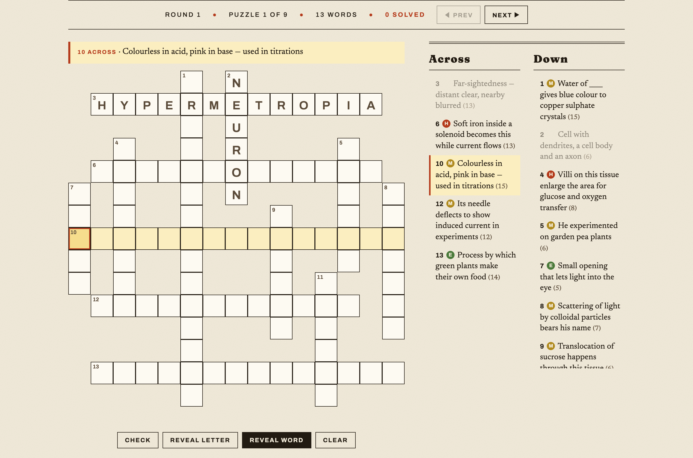
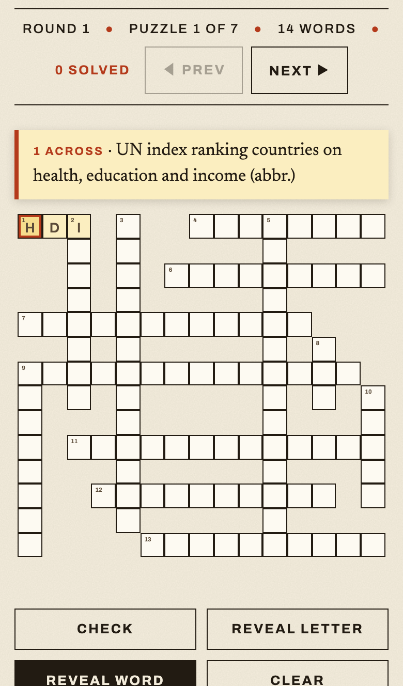

# The Crossword

An endless, auto-generated crossword game that runs entirely in the browser —
no backend, no build step, no dependencies. Pick a **Subject → Topic →
Subtopic** scope and a hint difficulty, and the generator lays out fresh
interlocking grids from a word database. Solve them all and it deals a new
round with different layouts and different hints, forever.

The bundled database contains **764 words with 4,000+ hints** covering every
chapter of the current (rationalised) NCERT Class 10 **Science** and **Social
Science** textbooks. Words and hint facts are drawn only from the textbook
text and chosen for exam revision value. The engine is
subject-agnostic: swap in any word list and it becomes a crossword site for
that corpus.

| Desktop | Mobile |
|---------|--------|
|  |  |

## Features

- **Pure static site** — three JS files, one HTML page, one stylesheet. Host it
  anywhere (GitHub Pages, Netlify, a USB stick, `file://`).
- **Client-side puzzle generator** with hard guarantees:
  - grid never exceeds **15×15**, words never exceed 15 letters;
  - any two words share **at most one cell** (a single common letter at a
    perpendicular crossing — parallel overlaps are rejected);
  - no **2×2 block** of the grid is ever fully filled;
  - placement maximises crossings, with random restarts per puzzle keeping the
    densest layout;
  - words that don't fit spill into **additional puzzles**, so the entire
    selected scope is always used across the set.
- **Endless rounds** — finishing every puzzle in a set unlocks a new round with
  reshuffled layouts; hints rotate so repeated words get different clues.
- **Three difficulty levels per word** (Easy / Medium / Hard), each clue tagged
  with a coloured chip; "All" mixes them.
- **Polished play experience** — click/tap to select, auto-advance typing,
  direction toggle, clickable clues, Check / Reveal letter / Reveal word /
  Clear, wrong-letter strikethrough, solved stamp.
- **Desktop and mobile friendly** — keyboard controls on desktop; on phones the
  layout stacks, the current clue stays pinned while you scroll, the soft
  keyboard is summoned on tap, and the active cell auto-scrolls clear of it.

## Quick start

```bash
git clone https://github.com/<username>/<repo>.git
cd <repo>
# open index.html directly, or serve the folder:
python3 -m http.server 8000   # → http://localhost:8000
```

## Deploy to GitHub Pages

1. Fork this repository (or push a copy to your own).
2. In the repo on GitHub: **Settings → Pages → Build and deployment →
   Source: Deploy from a branch → `main` / `(root)`**.
3. After a minute the game is live at
   `https://<username>.github.io/<repo>/`.

## How to play

1. Choose **Subject**, **Topic**, **Subtopic** and **Hint difficulty** — every
   selector has an *All* option — then hit **Set the Puzzles**.
2. Solve each puzzle in the set; use *Prev / Next* to move between them.

| Input | Action |
|-------|--------|
| Click / tap a square | Select it (tap again to switch Across ↔ Down) |
| Click / tap a clue | Jump to that word |
| Type letters | Fill and auto-advance along the word |
| `Backspace` | Erase (moves back when the square is empty) |
| Arrow keys | Move around the grid (first press turns the cursor) |
| `Space` | Toggle Across ↔ Down |
| `Tab` / `Shift+Tab` | Next / previous clue |

The grid auto-checks on completion. When every puzzle in the set is solved, a
**New round** button generates fresh layouts with different hints.

## Project layout

```
index.html        # the page
css/style.css     # newspaper-style theme, responsive rules
js/data.js        # THE DATABASE — words, subjects, topics, subtopics, hints
js/generator.js   # crossword generator + constraint validator
js/app.js         # game logic / UI wiring
docs/             # screenshots for this README
```

## Customising the database

All content lives in `js/data.js`. It holds one raw word list per subject and
merges them at the bottom of the file:

```js
const WORD_DB = [
  ...normalise(WORD_DB_SCIENCE, "Class 10 - Science"),
  ...normalise(WORD_DB_SOCIAL, "Class 10 - Social Science"),
];
```

### Add a word

Append an entry to the relevant subject's list:

```js
["WORD", "Topic", "Subtopic", [
  [1, "Easy hint"],
  [1, "Another easy hint (optional — rounds rotate through alternatives)"],
  [2, "Medium hint"],
  [3, "Hard hint"],
]],
```

Rules:

- Letters **A–Z only**, 2–15 characters. No spaces or hyphens — join multi-word
  answers (`AQUAREGIA`) and mention it in the hint, e.g. *"(two words, joined)"*.
- Difficulty levels: `1` Easy, `2` Medium, `3` Hard. A word may carry any
  number of hints at any levels; the game picks one matching the player's
  difficulty choice (nearest level as fallback, random when "All") and avoids
  repeating the previous round's hint when an alternative exists.
- Topics and subtopics are free-form strings — the selector dropdowns build
  themselves from whatever appears in the data.

### Add a subject

Create another raw list and register it in the merge:

```js
const WORD_DB_MATHS = [
  ["POLYNOMIAL", "Algebra", "Polynomials", [[1, "Expression with variables and coefficients"]]],
  // ...
];

const WORD_DB = [
  ...normalise(WORD_DB_SCIENCE, "Class 10 - Science"),
  ...normalise(WORD_DB_SOCIAL, "Class 10 - Social Science"),
  ...normalise(WORD_DB_MATHS, "Class 10 - Mathematics"),   // ← new line
];
```

That's it — the Subject dropdown picks it up automatically. The page carries no
subject-specific branding, so nothing else needs editing.

## Validating changes

`generator.js` exports `validateModel()`, which independently re-checks every
constraint (grid size, 2×2 rule, single-cell overlaps). After editing the
database, run:

```bash
node -e "
const { WORD_DB } = require('./js/data.js');
const Gen = require('./js/generator.js');
const puzzles = Gen.generateSet(WORD_DB, 42);
const errors = puzzles.flatMap(Gen.validateModel);
const placed = puzzles.reduce((n, p) => n + p.wordCount, 0);
console.log(puzzles.length + ' puzzles, ' + placed + '/' + WORD_DB.length + ' words placed');
console.log(errors.length === 0 ? 'OK' : errors);
"
```

Words that are skipped (too long, non-alphabetic, duplicates) are silently
dropped by the generator's sanitiser — if the placed count is lower than
expected, check your new entries against the rules above.

## How the generator works

1. Filter the database to the selected scope; sanitise and dedupe.
2. Seed a puzzle with the longest word near the centre of a 15×15 grid.
3. Repeatedly sweep the remaining words, computing every legal crossing
   placement for each; legality means: letters match, the word crosses
   perpendicular words only (one shared cell per pair), no flush parallel
   neighbours, ends are open, and no 2×2 window becomes fully filled.
4. Among candidates, prefer more crossings, then compactness.
5. Build each puzzle 14 times from different shuffles and keep the best
   (most words, then most crossings).
6. Start the next puzzle with whatever didn't fit; repeat until the scope is
   exhausted. Numbering, clue lists and the trimmed display grid are computed
   at the end.

A seeded PRNG (`mulberry32`) drives all randomness, so a given seed reproduces
the same puzzle set — handy for debugging.

## Contributing

Improvements welcome — more words and hints for existing chapters, new
subjects, or engine/UI enhancements. Please run the validation snippet above
before opening a pull request that touches `js/data.js`.
